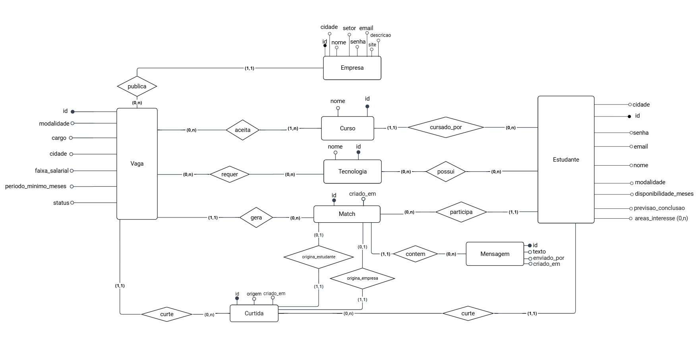

# ConetaAI

**Sistema para conectar estudantes e empresas em vagas de estágio por meio de "match".**

## Sobre o projeto

O ConetaAI funciona como um "match" entre estudantes e vagas de estágio. A empresa publica vagas informando os cursos aceitos, as tecnologias exigidas, a modalidade, a cidade e o período mínimo. O estudante cria um perfil com curso, habilidades, cidade, modalidade preferida e disponibilidade.

O sistema calcula um **score de compatibilidade** entre cada estudante e cada vaga (curso, habilidades, localização, modalidade e disponibilidade) e usa esse score para ordenar o que cada lado vê. Os dois lados curtem um ao outro: quando o estudante curte a vaga **e** a empresa curte o estudante para aquela vaga, acontece o **match** e os dois passam a conversar por um chat.

## Requisitos (regras de negócio)

**O que deve ser armazenado**
- Empresas, estudantes, vagas, cursos e tecnologias.
- As curtidas de cada lado, os matches e as mensagens trocadas em cada match.

**Regras**
- Cada vaga é publicada por exatamente uma empresa.
- Cada vaga aceita ao menos um curso e pode exigir várias tecnologias.
- Cada estudante cursa exatamente um curso e pode ter várias tecnologias (habilidades) e várias áreas de interesse.
- Cursos e tecnologias são **listas fechadas**: o usuário escolhe de uma lista, não digita livremente.
- O e-mail é único entre estudantes e único entre empresas.
- `modalidade` aceita: presencial, remoto ou hibrido.
- `status` da vaga aceita: Ativa ou Encerrada. Vaga encerrada não recebe curtidas.
- A curtida tem uma origem (`estudante` ou `empresa`) e não pode se repetir para o mesmo par (estudante, vaga, origem).
- O match só existe quando há uma curtida de cada origem para o mesmo par (estudante, vaga), e é único por par.
- A mensagem registra quem enviou (`estudante` ou `empresa`) e pertence a exatamente um match.
- Excluir uma vaga apaga também as curtidas, os matches e as mensagens dela.
- Só a empresa dona da vaga pode encerrá-la ou excluí-la.

## Modelo conceitual (diagrama ER)



Arquivo original em PDF: [docs/Modelo-ER.pdf](docs/Modelo-ER.pdf)

**Ferramenta:** Miro
**Notação:** estilo Peter Chen, com atributos como círculos (círculo preenchido = chave) e cardinalidade `(mín,máx)` em cada ligação.

**Como ler as cardinalidades:** o par escrito ao lado de uma entidade diz quantas daquelas entidades se relacionam com **uma** instância da outra. Exemplo: em `publica`, o `(1,1)` ao lado de Empresa significa que cada vaga tem exatamente 1 empresa, e o `(0,n)` ao lado de Vaga significa que uma empresa tem de 0 a n vagas.

### Entidades

| Entidade | Atributos |
|----------|-----------|
| Empresa | id, nome, email, senha, setor, cidade, descricao, site |
| Estudante | id, nome, email, senha, cidade, modalidade, disponibilidade_meses, previsao_conclusao, areas_interesse (multivalorado) |
| Vaga | id, cargo, modalidade, cidade, faixa_salarial, periodo_minimo_meses, status |
| Curso | id, nome |
| Tecnologia | id, nome |
| Curtida | id, origem, criado_em |
| Match | id, criado_em |
| Mensagem | id, texto, enviado_por, criado_em |

### Relacionamentos

| Relacionamento | Entidades | Cardinalidade |
|----------------|-----------|---------------|
| publica | Empresa – Vaga | Empresa (1,1) · Vaga (0,n) |
| aceita | Vaga – Curso | Vaga (0,n) · Curso (1,n) |
| requer | Vaga – Tecnologia | (0,n) · (0,n) |
| cursado_por | Curso – Estudante | Curso (1,1) · Estudante (0,n) |
| possui | Estudante – Tecnologia | (0,n) · (0,n) |
| curte | Vaga – Curtida | Vaga (1,1) · Curtida (0,n) |
| curte | Curtida – Estudante | Estudante (1,1) · Curtida (0,n) |
| gera | Vaga – Match | Vaga (1,1) · Match (0,n) |
| participa | Estudante – Match | Estudante (1,1) · Match (0,n) |
| contem | Match – Mensagem | Match (1,1) · Mensagem (0,n) |
| origina_estudante | Match – Curtida | Match (0,1) · Curtida (1,1) |
| origina_empresa | Match – Curtida | Match (0,1) · Curtida (1,1) |

A entidade **Curtida** existe porque há dois sentidos de curtida (estudante → vaga e empresa → estudante, para uma vaga), e o mesmo par (estudante, vaga) pode ter uma de cada. O atributo `origem` diz de qual lado ela veio. Na ligação com o Estudante, ele é o autor quando `origem = estudante` e o alvo quando `origem = empresa`.

Os dois relacionamentos entre Match e Curtida dizem de onde o match nasce: **`origina_estudante`** liga o Match à curtida do estudante e **`origina_empresa`** liga o Match à curtida da empresa, ambas do mesmo par (estudante, vaga). Em cada um, o Match tem a curtida obrigatória, `(1,1)`, e uma curtida origina no máximo um match, `(0,1)`. Assim o diagrama já diz que um match **só existe quando os dois lados curtiram**, e o banco garante isso sem triggers (veja [Como o banco garante a regra do match](#como-o-banco-garante-a-regra-do-match)).

## Modelo lógico (mapeamento ER → relacional)

Mapeamento feito com o algoritmo ER → relacional, a partir do diagrama acima.

| Passo do algoritmo | O que se aplica ao ConetaAI | Resultado |
|--------------------|-----------------------------|-----------|
| 1. Entidades regulares | Empresa, Estudante, Vaga, Curso, Tecnologia, Curtida, Match, Mensagem | 8 relações |
| 2. Entidades fracas | Nenhuma (todas têm `id` próprio) | – |
| 3. Relacionamentos 1:1 | `origina_estudante` e `origina_empresa`: chave estrangeira na entidade com participação total (Match) | 2 chaves estrangeiras em MATCH |
| 4. Relacionamentos 1:N | `publica`, `cursado_por`, `gera`, `participa`, `contem` e os dois `curte`: chave estrangeira na relação do lado N | chaves estrangeiras |
| 5. Relacionamentos M:N | `aceita`, `requer`, `possui`: uma nova relação para cada | 3 relações |
| 6. Atributo multivalorado | `areas_interesse`: uma nova relação | 1 relação |
| 7 a 10. N-ários, especialização, categoria, associativa | Não existem no ER | – |

Total: **12 relações**.

**Legenda:** `#` marca a chave primária. `referencia` indica a chave estrangeira. Os `id` são inteiros gerados automaticamente. Os atributos que aceitam `NULL` estão marcados com `?`; todos os demais são obrigatórios.

```
EMPRESA (#id, nome, email, senha, setor, cidade, descricao?, site?)
  UNIQUE (email)

ESTUDANTE (#id, nome, email, senha, cidade, modalidade, disponibilidade_meses,
           previsao_conclusao?, curso_id)
  UNIQUE (email)
  curso_id referencia CURSO (id)

VAGA (#id, cargo, modalidade, cidade?, faixa_salarial?, periodo_minimo_meses,
      status, empresa_id)
  empresa_id referencia EMPRESA (id)

CURSO (#id, nome)
  UNIQUE (nome)

TECNOLOGIA (#id, nome)
  UNIQUE (nome)

CURTIDA (#id, origem, criado_em, estudante_id, vaga_id)
  estudante_id referencia ESTUDANTE (id)
  vaga_id referencia VAGA (id)
  UNIQUE (estudante_id, vaga_id, origem)

MATCH (#id, criado_em, estudante_id, vaga_id, curtida_estudante_id, curtida_empresa_id)
  estudante_id referencia ESTUDANTE (id)
  vaga_id referencia VAGA (id)
  curtida_estudante_id referencia CURTIDA (id)        -- relacionamento origina_estudante
  curtida_empresa_id referencia CURTIDA (id)          -- relacionamento origina_empresa
  UNIQUE (vaga_id, estudante_id)
  UNIQUE (curtida_estudante_id)
  UNIQUE (curtida_empresa_id)

MENSAGEM (#id, texto, enviado_por, criado_em, match_id)
  match_id referencia MATCH (id)

VAGA_CURSO (#vaga_id, #curso_id)                          -- relacionamento aceita
  vaga_id referencia VAGA (id)
  curso_id referencia CURSO (id)

VAGA_TECNOLOGIA (#vaga_id, #tecnologia_id)                -- relacionamento requer
  vaga_id referencia VAGA (id)
  tecnologia_id referencia TECNOLOGIA (id)

ESTUDANTE_TECNOLOGIA (#estudante_id, #tecnologia_id)      -- relacionamento possui
  estudante_id referencia ESTUDANTE (id)
  tecnologia_id referencia TECNOLOGIA (id)

ESTUDANTE_AREA_INTERESSE (#estudante_id, #area)           -- atributo multivalorado
  estudante_id referencia ESTUDANTE (id)
```

### Chaves candidatas
Cada chave candidata vira uma cláusula `UNIQUE` no SQL: o `email` de empresa e de estudante, o `nome` de curso e de tecnologia, o par `(vaga_id, estudante_id)` do match, o trio `(estudante_id, vaga_id, origem)` da curtida e as colunas `curtida_estudante_id` e `curtida_empresa_id` do match (uma curtida origina no máximo um match).

### Restrições de domínio (`CHECK`)

| Atributo | Valores permitidos |
|----------|--------------------|
| `modalidade` (Estudante e Vaga) | `presencial`, `remoto`, `hibrido` |
| `status` (Vaga) | `Ativa`, `Encerrada` |
| `origem` (Curtida) | `estudante`, `empresa` |
| `enviado_por` (Mensagem) | `estudante`, `empresa` |
| `disponibilidade_meses`, `periodo_minimo_meses` | inteiro maior ou igual a 1 |
| `previsao_conclusao` | vazio ou `AAAA-MM` |

### Ações referenciais (o que acontece ao excluir)

| Ao excluir | Efeito |
|------------|--------|
| Empresa | exclui as vagas dela (e, por consequência, tudo que depende delas) |
| Vaga | exclui suas curtidas, matches, mensagens e as ligações em `VAGA_CURSO` e `VAGA_TECNOLOGIA` |
| Estudante | exclui suas curtidas, matches, mensagens e as ligações em `ESTUDANTE_TECNOLOGIA` e `ESTUDANTE_AREA_INTERESSE` |
| Match | exclui as mensagens dele; as curtidas permanecem |
| Curtida que originou um match | exclui também o match que dependia dela (e as mensagens dele): sem uma das curtidas, o match deixa de existir |
| Curso ou Tecnologia | **bloqueado** enquanto houver vaga ou estudante usando |

### Como o banco garante a regra do match

A regra "o match só existe quando há uma curtida de cada origem, do mesmo par (estudante, vaga)" é garantida **só com chaves estrangeiras, sem triggers**, a partir dos dois relacionamentos `origina_estudante` e `origina_empresa`:

- Pelo passo 3 do algoritmo (relacionamento 1:1), a chave estrangeira fica na entidade com **participação total**, o Match. Por isso `curtida_estudante_id` e `curtida_empresa_id` são **obrigatórias** (`NOT NULL`): não dá para criar um match sem as duas curtidas.
- Cada curtida origina no máximo um match, por isso as duas colunas são `UNIQUE`.
- No SQL, as duas chaves estrangeiras são **compostas**: além do id da curtida, incluem a origem e o par (estudante, vaga) do match. Assim o próprio banco recusa curtidas de outro estudante ou de outra vaga e curtidas com a origem errada (por exemplo, a curtida da empresa na coluna do estudante).
- Para que a origem possa fazer parte da chave composta, o MATCH tem duas colunas auxiliares de valor fixo, `origem_curtida_estudante` (sempre `'estudante'`) e `origem_curtida_empresa` (sempre `'empresa'`), protegidas por `CHECK`. Elas não carregam informação nova; existem só para a chave estrangeira conferir a origem.

Para criar o match, a aplicação busca as duas curtidas do par e as insere junto com o match. Se faltar uma delas, nada é inserido.

### Regras que ficam na aplicação
O modelo relacional não expressa estas regras apenas com chaves e `CHECK`:
- Vaga encerrada não recebe curtidas.
- Toda vaga aceita **ao menos um** curso (participação `(1,n)` de `aceita`). A chave estrangeira sozinha permitiria uma vaga sem curso.

## Tecnologias

| Camada | Tecnologia |
|--------|------------|
| Interface | HTML, CSS e JavaScript puro |
| Servidor | Node.js + Express |
| Banco de dados | PostgreSQL 18, acessado com SQL escrito à mão (sem ORM) |

## Estrutura do repositório

```
back/                        API (Node.js + Express)
  server.js                  ponto de entrada: confere o banco e sobe a API
  src/
    routes/                  rotas HTTP (uma por assunto) e regras de acesso
    repositorio/             acesso ao banco: todo o SQL escrito à mão
    db.js                    conexão com o PostgreSQL (driver pg)
    autenticacao.js          hash de senha e token de login
    validacao.js             validações usadas pelas rotas
    matchLogic.js            cálculo do score de compatibilidade
    assincrono.js            repassa erros das rotas assíncronas ao Express
  sql/                       scripts SQL: esquema, dados e consultas de exemplo
  scripts/gerar-hash.js      gera o hash de uma senha (para criar usuários no SQL)
front/                       interface web (HTML, CSS e JavaScript)
docs/                        diagrama ER (imagem e PDF)
```

## Como rodar

**1. Backend.** O PostgreSQL precisa estar rodando e o banco criado (veja [Banco de dados](#banco-de-dados-postgresql) abaixo). Dentro da pasta `back`, no **PowerShell**:

```powershell
npm install
$env:PGPASSWORD = "sua-senha-do-postgres"
npm start
```

Ou no **Prompt de Comando (cmd)**:

```cmd
npm install
set PGPASSWORD=sua-senha-do-postgres
npm start
```

A API sobe em `http://localhost:3000/api`. A senha é informada por variável de ambiente (nunca fica no código) e vale apenas na janela em que foi definida: se fechá-la, defina de novo. Opcionalmente defina também `SEGREDO_TOKEN` (veja [Segurança](#segurança)).

Ao iniciar, a API confere a conexão com o banco e mostra `Conectado ao PostgreSQL: banco "conetaai" ... (12 tabelas)`. Se o serviço estiver parado, a senha estiver errada ou o banco não existir, ela explica o que fazer.

**2. Frontend.** Em outro terminal, sirva a pasta `front/`:

```bash
cd front
npx serve
```

Detalhes de cada parte: [back/README.md](back/README.md) e [front/README.md](front/README.md).

## Banco de dados (PostgreSQL)

Os scripts ficam em [back/sql/](back/sql/):

| Arquivo | O que faz |
|---------|-----------|
| `01_schema.sql` | Cria as 12 tabelas do modelo lógico, com chaves, `UNIQUE`, `CHECK` e `ON DELETE`, e as chaves estrangeiras compostas que garantem a regra do match (sem triggers). Pode ser executado de novo: apaga e recria tudo. |
| `02_seed.sql` | Povoa o banco com os dados de demonstração (2 empresas, 4 estudantes, 3 vagas, 13 cursos e 19 tecnologias). |
| `03_consultas_exemplo.sql` | Cinco consultas de exemplo (junções, agregações e subconsultas) para conferir o banco. |

Para criar o banco e executar os scripts, no `cmd`, a partir da pasta raiz do repositório:

```cmd
chcp 65001
set PATH=%PATH%;C:\Program Files\PostgreSQL\18\bin

psql -U postgres -c "CREATE DATABASE conetaai WITH ENCODING 'UTF8' TEMPLATE template0;"
psql -U postgres -d conetaai -v ON_ERROR_STOP=1 -f back\sql\01_schema.sql
psql -U postgres -d conetaai -v ON_ERROR_STOP=1 -f back\sql\02_seed.sql
psql -U postgres -d conetaai -f back\sql\03_consultas_exemplo.sql
```

O `psql` pede a senha do usuário `postgres` definida na instalação do PostgreSQL. O serviço do PostgreSQL precisa estar em execução.

Todo o SQL da aplicação está em [`back/src/repositorio/`](back/src/repositorio/), escrito à mão; o driver `pg` apenas abre a conexão. Os dados cadastrados pelo sistema ficam no banco e continuam lá depois de reiniciar a API.

## Logins de teste

O banco já vem com seis perfis de demonstração (criados pelo `02_seed.sql`). **A senha de todos é `123456`.**

### Estudantes (marque "Estudante" na tela de login)

| Nome | E-mail | Senha | Curso | Cidade · modalidade | Habilidades |
|------|--------|-------|-------|---------------------|-------------|
| Luan | `luan@email.com` | `123456` | Sistemas de Informação | Belo Horizonte · híbrido | javascript, sql, git, react |
| Marina Alves | `marina@email.com` | `123456` | Sistemas de Informação | Belo Horizonte · híbrido | javascript, sql, react, css |
| Pedro Souza | `pedro@email.com` | `123456` | Ciência da Computação | Belo Horizonte · presencial | python, sql |
| Bianca Ferreira | `bianca@email.com` | `123456` | Engenharia de Software | Contagem · remoto | javascript, react, typescript |

### Empresas (marque "Empresa" na tela de login)

| Empresa | E-mail | Senha | Setor | Vagas |
|---------|--------|-------|-------|-------|
| Nortel Sistemas | `contato@nortelsistemas.com.br` | `123456` | Tecnologia da Informação | Engenharia de Software e Infraestrutura (Belo Horizonte) |
| Vetta Data | `contato@vettadata.com` | `123456` | Dados e Analytics | Análise de Dados (São Paulo, remoto) |

### Roteiro rápido para ver um match
1. Entre como **Luan** e curta a vaga "Estágio em Engenharia de Software" (aba Vagas ou Buscar).
2. Saia e entre como **Nortel Sistemas**. Em "Ver candidatos" dessa vaga, curta o **Luan**: aparece "Deu match!".
3. Abra o chat e troque mensagens; depois entre como Luan de novo para ver a conversa do outro lado.

### Observações
- No banco as senhas **não aparecem em texto**: cada uma é guardada como hash `scrypt`, com sal próprio (veja [Segurança](#segurança)). A senha `123456` só existe aqui na documentação.
- Contas criadas pela tela de **Cadastre-se** usam a senha que a pessoa escolher (mínimo de 6 caracteres).
- Para criar outro usuário de teste direto no SQL, gere o hash da senha: `node scripts/gerar-hash.js <senha>`, dentro da pasta `back`.
- Se os logins acima forem recusados ("E-mail ou senha inválidos"), o banco provavelmente foi criado com uma versão antiga dos scripts: rode de novo `back/sql/01_schema.sql` e `back/sql/02_seed.sql`.

## Segurança

| Tema | Como está |
|------|-----------|
| **Senhas** | Guardadas como hash `scrypt` (algoritmo próprio para senhas, lento de propósito) com sal aleatório por senha. Duas pessoas com a mesma senha têm hashes diferentes. A API nunca devolve a senha nem o hash. |
| **Login** | `POST /api/auth/login` devolve um **token** assinado (formato JWT, HS256) com o id, o tipo (estudante ou empresa) e a validade de 8 horas. |
| **Token** | O front envia `Authorization: Bearer <token>` em toda chamada. Quem está logado vem **do token**, nunca de um id digitado pelo cliente. Token ausente, adulterado, expirado ou assinado com outro segredo é recusado (401). |
| **Autorização** | Cada pessoa só mexe no que é seu: o estudante vê e edita só o próprio perfil e os próprios matches; a empresa só gerencia as próprias vagas, vê candidatos só das vagas dela e só curte em nome dela; só os participantes de um match leem e escrevem no chat. Tentativas contra dados de outra pessoa recebem 403. |
| **SQL injection** | Todo SQL usa parâmetros (`$1`, `$2`...); os valores nunca são colados no texto do comando. |
| **Segredo do token** | Vem da variável `SEGREDO_TOKEN`. Se ela não existir, a API cria um segredo temporário ao iniciar, e os logins valem só até reiniciar a API. |

Para manter os logins válidos mesmo depois de reiniciar a API, defina um segredo fixo (qualquer texto longo) antes do `npm start`:

```powershell
$env:SEGREDO_TOKEN = "um-texto-longo-e-aleatorio"
```
```cmd
set SEGREDO_TOKEN=um-texto-longo-e-aleatorio
```

**Limitações conhecidas (é um protótipo):** não há limite de tentativas de login, a comunicação é HTTP e não HTTPS, o token fica só na memória da página (recarregar a página pede o login de novo), o servidor não "revoga" tokens antes de vencerem e o CORS aceita chamadas de qualquer origem (os dados continuam protegidos pelo token).
