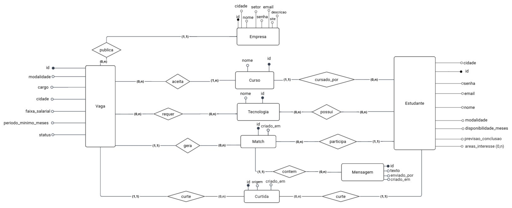

# ConetaAI

**Sistema para conectar estudantes e empresas em vagas de estágio por meio de "match".**


## Sobre o projeto

O ConetaAI funciona como um "match" entre estudantes e vagas de estágio. A empresa publica vagas informando os cursos aceitos, as tecnologias exigidas, a modalidade, a cidade e o período mínimo. O estudante cria um perfil com curso, habilidades, cidade, modalidade preferida e disponibilidade.

O sistema calcula um **score de compatibilidade** entre cada estudante e cada vaga (curso, habilidades, localização, modalidade e disponibilidade) e usa esse score para ordenar o que cada lado vê. Os dois lados curtem um ao outro: quando o estudante curte a vaga **e** a empresa curte o estudante para aquela vaga, acontece o **match** e os dois passam a conversar por um chat.

## Requisitos (regras de negócio)

**O que deve ser armazenado**
- Empresas, estudantes, vagas, cursos e tecnologias.
- As curtidas de cada lado, os matches e as mensagens trocadas em cada match.

**Regras**
- Cada vaga é publicada por exatamente uma empresa.
- Cada vaga aceita ao menos um curso e pode exigir várias tecnologias.
- Cada estudante cursa exatamente um curso e pode ter várias tecnologias (habilidades) e várias áreas de interesse.
- Cursos e tecnologias são **listas fechadas**: o usuário escolhe de uma lista, não digita livremente.
- O e-mail é único entre estudantes e único entre empresas.
- `modalidade` aceita: presencial, remoto ou hibrido.
- `status` da vaga aceita: Ativa ou Encerrada. Vaga encerrada não recebe curtidas.
- A curtida tem uma origem (`estudante` ou `empresa`) e não pode se repetir para o mesmo par (estudante, vaga, origem).
- O match só existe quando há uma curtida de cada origem para o mesmo par (estudante, vaga), e é único por par.
- A mensagem registra quem enviou (`estudante` ou `empresa`) e pertence a exatamente um match.
- Excluir uma vaga apaga também as curtidas, os matches e as mensagens dela.
- Só a empresa dona da vaga pode encerrá-la ou excluí-la.

## Modelo conceitual (diagrama ER)



Arquivo original em PDF: [docs/Modelo-ER.pdf](docs/Modelo-ER.pdf)

**Ferramenta:** Miro
**Notação:** estilo Peter Chen, com atributos como círculos (círculo preenchido = chave) e cardinalidade `(mín,máx)` em cada ligação.

**Como ler as cardinalidades:** o par escrito ao lado de uma entidade diz quantas daquelas entidades se relacionam com **uma** instância da outra. Exemplo: em `publica`, o `(1,1)` ao lado de Empresa significa que cada vaga tem exatamente 1 empresa, e o `(0,n)` ao lado de Vaga significa que uma empresa tem de 0 a n vagas.

### Entidades

| Entidade | Atributos |
|----------|-----------|
| Empresa | id, nome, email, senha, setor, cidade, descricao, site |
| Estudante | id, nome, email, senha, cidade, modalidade, disponibilidade_meses, previsao_conclusao, areas_interesse (multivalorado) |
| Vaga | id, cargo, modalidade, cidade, faixa_salarial, periodo_minimo_meses, status |
| Curso | id, nome |
| Tecnologia | id, nome |
| Curtida | id, origem, criado_em |
| Match | id, criado_em |
| Mensagem | id, texto, enviado_por, criado_em |

### Relacionamentos

| Relacionamento | Entidades | Cardinalidade |
|----------------|-----------|---------------|
| publica | Empresa – Vaga | Empresa (1,1) · Vaga (0,n) |
| aceita | Vaga – Curso | Vaga (0,n) · Curso (1,n) |
| requer | Vaga – Tecnologia | (0,n) · (0,n) |
| cursado_por | Curso – Estudante | Curso (1,1) · Estudante (0,n) |
| possui | Estudante – Tecnologia | (0,n) · (0,n) |
| curte | Vaga – Curtida | Vaga (1,1) · Curtida (0,n) |
| curte | Curtida – Estudante | Estudante (1,1) · Curtida (0,n) |
| gera | Vaga – Match | Vaga (1,1) · Match (0,n) |
| participa | Estudante – Match | Estudante (1,1) · Match (0,n) |
| contem | Match – Mensagem | Match (1,1) · Mensagem (0,n) |

A entidade **Curtida** existe porque há dois sentidos de curtida (estudante → vaga e empresa → estudante, para uma vaga), e o mesmo par (estudante, vaga) pode ter uma de cada. O atributo `origem` diz de qual lado ela veio. Na ligação com o Estudante, ele é o autor quando `origem = estudante` e o alvo quando `origem = empresa`.

## Modelo lógico (mapeamento ER → relacional)

Mapeamento feito com o algoritmo ER → relacional, a partir do diagrama acima.

| Passo do algoritmo | O que se aplica ao ConetaAI | Resultado |
|--------------------|-----------------------------|-----------|
| 1. Entidades regulares | Empresa, Estudante, Vaga, Curso, Tecnologia, Curtida, Match, Mensagem | 8 relações |
| 2. Entidades fracas | Nenhuma (todas têm `id` próprio) | – |
| 3. Relacionamentos 1:1 | Nenhum | – |
| 4. Relacionamentos 1:N | `publica`, `cursado_por`, `gera`, `participa`, `contem` e os dois `curte`: chave estrangeira na relação do lado N | chaves estrangeiras |
| 5. Relacionamentos M:N | `aceita`, `requer`, `possui`: uma nova relação para cada | 3 relações |
| 6. Atributo multivalorado | `areas_interesse`: uma nova relação | 1 relação |
| 7 a 10. N-ários, especialização, categoria, associativa | Não existem no ER | – |

Total: **12 relações**.

**Legenda:** `#` marca a chave primária. `referencia` indica a chave estrangeira. Os `id` são inteiros gerados automaticamente. Os atributos que aceitam `NULL` estão marcados com `?`; todos os demais são obrigatórios.

```
EMPRESA (#id, nome, email, senha, setor, cidade, descricao?, site?)
  UNIQUE (email)

ESTUDANTE (#id, nome, email, senha, cidade, modalidade, disponibilidade_meses,
           previsao_conclusao?, curso_id)
  UNIQUE (email)
  curso_id referencia CURSO (id)

VAGA (#id, cargo, modalidade, cidade?, faixa_salarial?, periodo_minimo_meses,
      status, empresa_id)
  empresa_id referencia EMPRESA (id)

CURSO (#id, nome)
  UNIQUE (nome)

TECNOLOGIA (#id, nome)
  UNIQUE (nome)

CURTIDA (#id, origem, criado_em, estudante_id, vaga_id)
  estudante_id referencia ESTUDANTE (id)
  vaga_id referencia VAGA (id)
  UNIQUE (estudante_id, vaga_id, origem)

MATCH (#id, criado_em, estudante_id, vaga_id)
  estudante_id referencia ESTUDANTE (id)
  vaga_id referencia VAGA (id)
  UNIQUE (vaga_id, estudante_id)

MENSAGEM (#id, texto, enviado_por, criado_em, match_id)
  match_id referencia MATCH (id)

VAGA_CURSO (#vaga_id, #curso_id)                          -- relacionamento aceita
  vaga_id referencia VAGA (id)
  curso_id referencia CURSO (id)

VAGA_TECNOLOGIA (#vaga_id, #tecnologia_id)                -- relacionamento requer
  vaga_id referencia VAGA (id)
  tecnologia_id referencia TECNOLOGIA (id)

ESTUDANTE_TECNOLOGIA (#estudante_id, #tecnologia_id)      -- relacionamento possui
  estudante_id referencia ESTUDANTE (id)
  tecnologia_id referencia TECNOLOGIA (id)

ESTUDANTE_AREA_INTERESSE (#estudante_id, #area)           -- atributo multivalorado
  estudante_id referencia ESTUDANTE (id)
```

### Chaves candidatas
Cada chave candidata vira uma cláusula `UNIQUE` no SQL: o `email` de empresa e de estudante, o `nome` de curso e de tecnologia, o par `(vaga_id, estudante_id)` do match e o trio `(estudante_id, vaga_id, origem)` da curtida.

### Restrições de domínio (`CHECK`)

| Atributo | Valores permitidos |
|----------|--------------------|
| `modalidade` (Estudante e Vaga) | `presencial`, `remoto`, `hibrido` |
| `status` (Vaga) | `Ativa`, `Encerrada` |
| `origem` (Curtida) | `estudante`, `empresa` |
| `enviado_por` (Mensagem) | `estudante`, `empresa` |
| `disponibilidade_meses`, `periodo_minimo_meses` | inteiro maior ou igual a 1 |
| `previsao_conclusao` | vazio ou `AAAA-MM` |

### Ações referenciais (o que acontece ao excluir)

| Ao excluir | Efeito |
|------------|--------|
| Empresa | exclui as vagas dela (e, por consequência, tudo que depende delas) |
| Vaga | exclui suas curtidas, matches, mensagens e as ligações em `VAGA_CURSO` e `VAGA_TECNOLOGIA` |
| Estudante | exclui suas curtidas, matches, mensagens e as ligações em `ESTUDANTE_TECNOLOGIA` e `ESTUDANTE_AREA_INTERESSE` |
| Match | exclui as mensagens dele |
| Curso ou Tecnologia | **bloqueado** enquanto houver vaga ou estudante usando |

### Regras que ficam na aplicação
O modelo relacional não consegue expressar estas regras apenas com chaves e restrições:
- O match só é criado quando existem as duas curtidas (uma de cada origem) para o mesmo par (estudante, vaga).
- Vaga encerrada não recebe curtidas.
- Toda vaga aceita **ao menos um** curso (participação `(1,n)` de `aceita`). A chave estrangeira sozinha permitiria uma vaga sem curso.
- Só a empresa dona da vaga pode curtir candidatos dela, encerrá-la ou excluí-la.


## Tecnologias

| Camada | Tecnologia |
|--------|------------|
| Interface | HTML, CSS e JavaScript puro |
| Servidor | Node.js + Express |
| Banco de dados | [PREENCHER: SGBD relacional escolhido], acessado com SQL escrito à mão (sem ORM) |

## Estrutura do repositório

```
back/     API (Node.js + Express)
  src/routes/       rotas HTTP
  src/repositorio/  acesso aos dados (será reescrito com SQL)
  src/data.js       armazenamento em memória (provisório)
front/    interface web
docs/     diagrama ER e demais documentos
```

## Como rodar

```bash
# 1. backend
cd back
npm install
npm start          # sobe em http://localhost:3000/api

# 2. frontend: em outro terminal, sirva a pasta front/
cd front
npx serve
```

Detalhes de cada parte: [back/README.md](back/README.md) e [front/README.md](front/README.md).

**Usuários de teste** (senha `123456`)

| Tipo | E-mail |
|------|--------|
| Estudante | luan@email.com |
| Estudante | marina@email.com |
| Empresa | contato@nortelsistemas.com.br |
| Empresa | contato@vettadata.com |

Também é possível criar contas novas pela tela de cadastro.

## Andamento

- [x] Etapa 1: definição do problema
- [x] Etapa 2: diagrama entidade-relacionamento
- [x] Etapa 3: modelo lógico (mapeamento ER → relacional)
- [ ] Etapa 4: scripts SQL de criação e povoamento
- [ ] Integração da API com o SGBD (hoje os dados ficam em memória e reiniciam com o servidor)
- [ ] Etapa 5: vídeo de apresentação (até 10 min)
